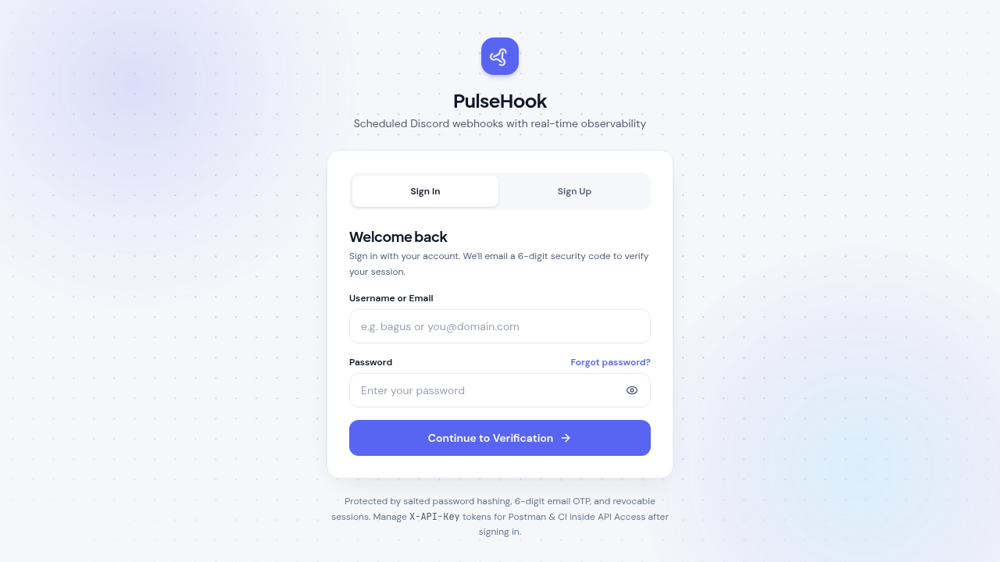
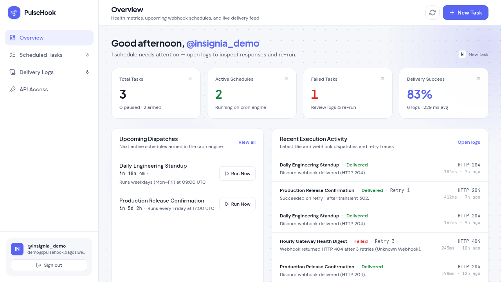
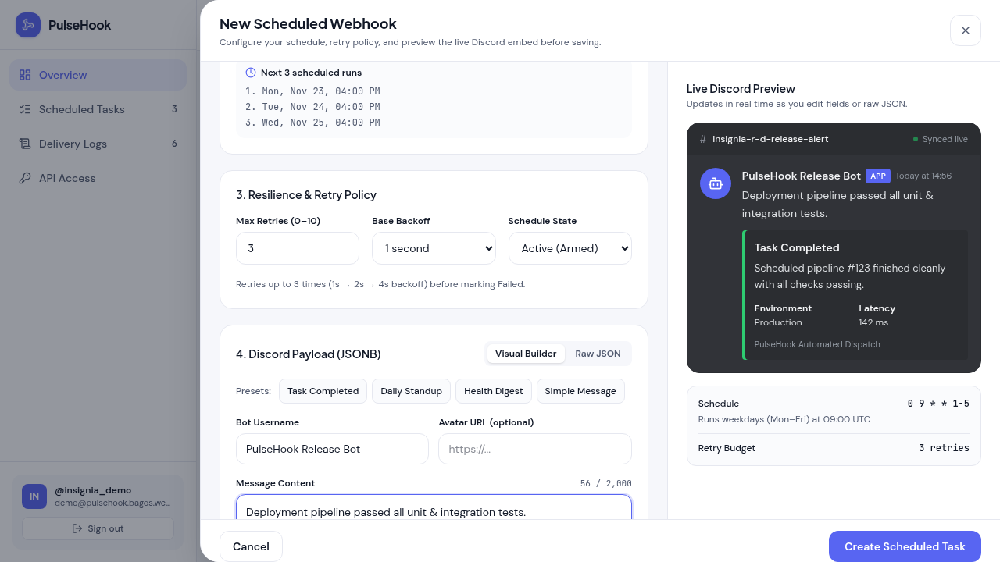
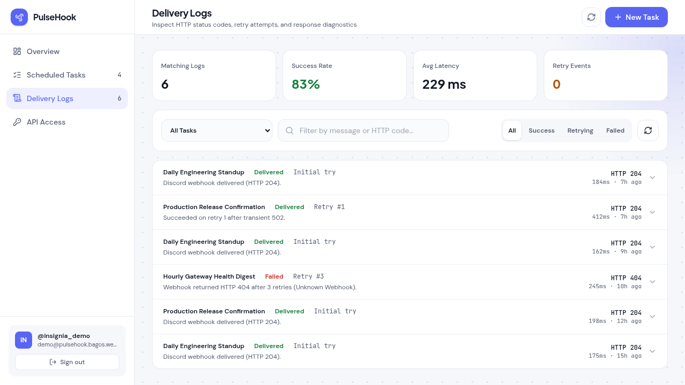
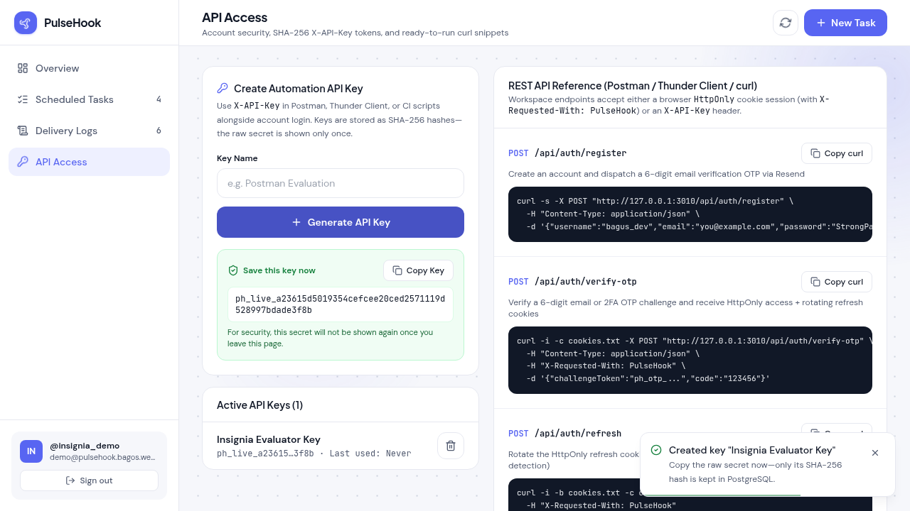

# PulseHook: Scheduled Discord Webhook Task Manager

PulseHook is an Insignia Technical Test submission for scheduling, testing, and auditing recurring Discord webhook deliveries. The monorepo pairs a Next.js 16 workspace with a Flask API, PostgreSQL 16, Alembic migrations, and a dual scheduler that uses Upstash QStash when configured or APScheduler locally.

## Live Deployment (Bonus)

[Open PulseHook](https://pulsehook.bagos.web.id)

The live deployment runs on a personal VPS with Cloudflare DNS and Cloudflare Tunnel providing public HTTPS ingress.

## Walkthrough Video & UI Screenshots

[Watch the walkthrough video on the v1.0.0 GitHub Release](https://github.com/volumeee/pulsehook-discord-scheduler/releases/tag/v1.0.0)

### Authentication



### Dashboard overview



### Task editor and Discord embed builder



### Execution logs



### API access



## Architecture & Monorepo Layout

```text
.
├── backend/                               # Flask API, Gunicorn, SQLAlchemy, Alembic
│   ├── app/
│   │   ├── middleware/                    # Cookie/CSRF and API-key authentication guards
│   │   ├── models/                        # User, OTP, session, task, log, and API-key models
│   │   ├── routes/                        # Auth, task, log/stat, key, and health endpoints
│   │   ├── schemas/                       # Pydantic validation, cron parsing, SSRF guard
│   │   └── services/                      # Auth, email, Discord, retries, scheduler, QStash, samples
│   ├── migrations/versions/               # Six Alembic revisions
│   ├── tests/                             # Pytest coverage for backend behavior
│   ├── gunicorn.conf.py                   # Single scheduler worker configuration
│   └── wsgi.py                            # Production WSGI entry point
├── frontend/                              # Next.js 16 App Router application
│   ├── src/
│   │   ├── app/                           # Pages, layouts, styles, password reset
│   │   ├── components/
│   │   │   └── workspace/                 # WorkspaceSidebar.tsx, WorkspaceHeader.tsx,
│   │   │                                   # MobileNavigation.tsx
│   │   ├── lib/                           # Typed API client
│   │   ├── types/                         # Shared models, including types/auth.ts
│   │   └── utils/                         # Cron, payload, password, templates, utils/time.ts
│   └── package.json
├── docs/
│   ├── screenshots/                       # Submitted UI screenshots
│   ├── pulsehook.postman_collection.json
│   └── pulsehook.thunderclient_collection.json
├── scripts/                               # dev.mjs, start.mjs, ensure-backend.mjs
├── docker-compose.yml                     # Postgres, API, web, optional tunnel
└── .env.example                           # Optional runtime and external-service settings
```

### Runtime flow

1. The Next.js workspace calls the Flask API through `/api/*` rewrites.
2. Flask validates requests, tenant ownership, cron expressions, and Discord webhook targets.
3. PostgreSQL stores users, sessions, tasks, API keys, and delivery history.
4. QStash owns scheduled deliveries when configured. APScheduler runs the same task model locally when QStash is absent.
5. The executor sends Discord webhooks, handles retries and rate limits, then records task logs.

## Quick Start: Single-Command Docker Compose

Run the full local stack with no manual `.env` setup:

```bash
docker compose up --build
```

This starts PostgreSQL 16, applies Alembic migrations, launches Flask with Gunicorn, and serves the Next.js app. Open `http://localhost:3000`; API health is available at `http://localhost:5001/api/health` and through the web proxy at `/api/health`.

For the production tunnel profile, provide the Cloudflare tunnel token through the deployment environment and run:

```bash
docker compose --profile tunnel up -d --build
```

### Scheduler configuration

- Leave `QSTASH_TOKEN` unset to use the included APScheduler fallback.
- Set `QSTASH_TOKEN` to use Upstash QStash v2 schedules.
- Set `VPS_KEEPALIVE_CRON` with `APP_BASE_URL` to schedule an optional QStash health ping.
- Set `ALLOW_REGISTRATION=false` after initial account provisioning to close public registration.

## Local Development (Without Docker)

Prerequisites: Node.js 22+, Python 3.12+, and a reachable PostgreSQL 16 instance.

```bash
npm --prefix frontend install
node scripts/dev.mjs
```

`scripts/dev.mjs` creates or reuses `backend/.venv`, upgrades the schema, starts Gunicorn on `127.0.0.1:5001`, and starts Next.js on port 3000.

Run the production-style local runner after building the frontend:

```bash
npm --prefix frontend run build
node scripts/start.mjs
```

## Database Schema & Migrations (No Manual SQL)

PostgreSQL 16 is managed through SQLAlchemy models and Alembic. Application startup and Docker containers run `alembic upgrade head`, so schema changes do not require manual SQL.

Core tables include:

| Table | Purpose |
| --- | --- |
| `users` | Account identity and password credentials. |
| `otp_codes` | Short-lived email verification and sign-in challenges. |
| `user_sessions` | Rotating, revocable browser sessions and session families. |
| `password_reset_tokens` | Single-use password reset tokens. |
| `tasks` | Tenant-owned schedule, status, retry configuration, webhook URL, and `payload` as PostgreSQL `JSONB`. |
| `task_logs` | Delivery outcomes, attempt metadata, and QStash `external_id` idempotency tracking. |
| `api_keys` | Per-user SHA-256-hashed API credentials. |

| Revision | Migration |
| --- | --- |
| `20261121_0001` | Initial schema: `tasks` with JSONB payload, `task_logs`, and `api_keys`. |
| `20261121_0002` | User accounts, OTP codes, and browser sessions. |
| `20261121_0003` | Refresh-session family rotation and password reset tokens. |
| `20261122_0004` | Tenant ownership foreign keys for tasks and API keys. |
| `20261122_0005` | Hardening constraints and indexes. |
| `20261122_0006` | `task_logs.external_id` for idempotent QStash v2 log synchronization. |

## API Endpoints & API Collections

Authentication is either an authenticated browser session with CSRF protection or a per-user `X-API-Key`, as listed below.

| Method | Endpoint | Access | Purpose |
| --- | --- | --- | --- |
| `GET` | `/api/health` | Public | Return service health. |
| `GET` | `/api/auth/status` | Public | Return registration and email-provider readiness. |
| `POST` | `/api/auth/register` | Public | Register with `username`, `email`, and `password`. |
| `POST` | `/api/auth/login` | Public | Start an OTP login with `identifier` and `password`. |
| `POST` | `/api/auth/verify-otp` | Public | Verify `challengeToken` and OTP `code`. |
| `POST` | `/api/auth/resend-otp` | Public | Resend an OTP for `challengeToken`. |
| `POST` | `/api/auth/refresh` | Cookie + CSRF | Rotate the refresh session. |
| `POST` | `/api/auth/logout` | Cookie + CSRF | Revoke the session and clear cookies. |
| `POST` | `/api/auth/forgot-password` | Public | Request a password reset for `identifier`. |
| `POST` | `/api/auth/reset-password/validate` | Public | Validate a reset `token`. |
| `POST` | `/api/auth/reset-password` | Public | Set `newPassword` for a reset `token`. |
| `GET` | `/api/auth/me` | Cookie or API key | Return the authenticated user. |
| `GET` | `/api/tasks` | Cookie or API key | List tasks, with optional `status` and `search`. |
| `POST` | `/api/tasks` | Cookie or API key | Create a task. |
| `GET` | `/api/tasks/:id` | Cookie or API key | Get one task. |
| `PATCH` | `/api/tasks/:id` | Cookie or API key | Update one task. |
| `DELETE` | `/api/tasks/:id` | Cookie or API key | Delete one task. |
| `POST` | `/api/tasks/:id/run` | Cookie or API key | Run a task immediately. |
| `POST` | `/api/tasks/:id/duplicate` | Cookie or API key | Create a paused duplicate. |
| `POST` | `/api/tasks/seed-samples` | Cookie or API key | Seed starter task samples. |
| `GET` | `/api/logs` | Cookie or API key | Query logs with `taskId`, `status`, `search`, `limit`, and `page`. |
| `GET` | `/api/stats` | Cookie or API key | Return task and delivery summary metrics. |
| `GET` | `/api/keys` | Cookie or API key | List API-key metadata. |
| `POST` | `/api/keys` | Cookie or API key | Create an API key from `name`. |
| `DELETE` | `/api/keys/:id` | Cookie or API key | Revoke an API key. |

### Postman and Thunder Client

Import either collection from the repository:

- [Postman collection](docs/pulsehook.postman_collection.json): in Postman, select **Import**, choose the file, then set the `baseUrl` and `apiKey` variables.
- [Thunder Client collection](docs/pulsehook.thunderclient_collection.json): in VS Code Thunder Client, select **Collections**, then **Import** and choose the file. Set the equivalent environment values before sending protected requests.

### cURL example

```bash
curl -X POST "https://pulsehook.bagos.web.id/api/tasks" \
  -H "Content-Type: application/json" \
  -H "X-API-Key: YOUR_API_KEY" \
  -d '{
    "name": "Daily engineering standup",
    "schedule": "0 9 * * 1-5",
    "webhookUrl": "https://discord.com/api/webhooks/WEBHOOK_ID/WEBHOOK_TOKEN",
    "payload": {"content": "Share your daily update."},
    "maxRetry": 3,
    "retryDelayMs": 1000,
    "status": "active"
  }'
```

## Unit Testing & Quality Gates

Run the project checks with:

```bash
backend/.venv/bin/ruff check backend
backend/.venv/bin/pytest backend/tests
npm --prefix frontend run check
```

The backend suite contains 55 tests. The frontend `node:test` suite contains 27 tests and is included by `npm --prefix frontend run check`.

| Required PDF area | Coverage |
| --- | --- |
| Task CRUD | `test_tasks_crud.py` covers create, read, update, delete, search, status, duplicate, and seed samples. |
| Scheduler execution | `test_scheduler.py` and `test_qstash_scheduler.py` cover APScheduler and QStash scheduling behavior. |
| Retry mechanism | `test_retry_executor.py` covers retries, exponential backoff, rate-limit handling, and failure escalation. |
| API auth middleware | `test_auth_middleware.py` covers browser sessions, CSRF enforcement, and API-key access. |
| Mocked Discord webhook | `test_discord_webhook.py` covers payload dispatch and webhook response handling without external Discord calls. |
| Tenant authorization | `test_tenant_authorization.py` and `test_ownership_migration.py` verify ownership isolation and the ownership migration. |
| OTP authentication | `test_account_otp_auth.py` covers registration, OTP verification, login challenges, and reset flows. |
| QStash integration | `test_qstash_scheduler.py` verifies QStash schedule and idempotent log synchronization paths. |
| Frontend units | 27 tests cover OTP digits, reset tokens, payloads, log query parsing, workspace refresh, cron text, Discord templates, password strength, and time utilities. |

## CLI Coding Agent Utilization

The project used CLI coding agents to maintain explicit plans and executable TODO lists throughout the technical test.

### Instance 1: Initial Project Setup & Monorepo Architecture

Tool: Claude Code

```text
PLAN
1. Create frontend and backend workspaces with independent dependency manifests.
2. Add Docker Compose for Postgres, Flask, and Next.js.
3. Add shared scripts for one-command local development.

TODO
- [x] Scaffold Next.js App Router frontend.
- [x] Configure Flask WSGI application and Gunicorn.
- [x] Define Docker networking and health checks.
```

### Instance 2: PostgreSQL JSONB Database Schema & Alembic Migrations

Tool: Gemini CLI

```text
PLAN
1. Model tasks and task logs with SQLAlchemy.
2. Store webhook payloads in PostgreSQL JSONB.
3. Create Alembic revisions for accounts, sessions, ownership, and constraints.

TODO
- [x] Add tasks.payload JSONB column.
- [x] Create task_logs and external-id support.
- [x] Apply tenant ownership and database constraints.
```

### Instance 3: API Endpoint Planning, SSRF Guard & Dual Scheduler

Tool: OMP

```text
PLAN
1. Define authenticated REST routes for auth, tasks, logs, stats, and API keys.
2. Restrict outbound webhook URLs to Discord HTTPS hosts.
3. Schedule with QStash when configured and APScheduler otherwise.

TODO
- [x] Implement cookie plus CSRF and X-API-Key authentication.
- [x] Add Discord-host allowlist validation.
- [x] Add QStash schedules and APScheduler fallback.
```

### Instance 4: Unit Test Generation & Modular Refactoring

Tool: Claude Code

```text
PLAN
1. Split task execution, scheduling, authentication, and Discord delivery services.
2. Add backend coverage for required technical-test behaviors.
3. Add frontend unit tests for form and workspace utilities.

TODO
- [x] Cover 55 backend tests for CRUD, scheduler, retries, auth, and Discord mocks.
- [x] Cover tenant, OTP, and QStash paths.
- [x] Add 27 frontend node:test cases.
```

## Open-Source Libraries Used

### Backend runtime

| Library | Version | Purpose |
| --- | --- | --- |
| Flask | 3.1.1 | HTTP application and routing. |
| Gunicorn | 23.0.0 | Production WSGI server. |
| SQLAlchemy | 2.0.41 | ORM and database access. |
| Alembic | 1.16.2 | Versioned database migrations. |
| psycopg[binary] | 3.2.9 | PostgreSQL driver. |
| APScheduler | 3.11.0 | Local scheduler fallback. |
| croniter | 6.0.0 | Cron expression evaluation. |
| pydantic | 2.11.5 | Request and domain validation. |
| requests | 2.32.4 | Discord webhook HTTP client. |
| python-dotenv | 1.1.0 | Environment configuration loading. |
| flask-cors | 6.0.1 | CORS policy support. |

### Backend development

| Library | Version | Purpose |
| --- | --- | --- |
| pytest | 8.4.1 | Backend test runner. |
| ruff | `>=0.11.0` | Python linting. |

### Frontend runtime

| Library | Version | Purpose |
| --- | --- | --- |
| next | `^16.4.6` | React App Router framework. |
| react | `^19.0.1` | UI runtime. |
| react-dom | `^19.0.1` | DOM renderer. |
| motion | `^12.23.24` | Interface animation. |
| lucide-react | `^0.546.0` | Interface icon components. |
| croner | `^11.0.1` | Cron parsing and scheduling utilities. |
| @tailwindcss/postcss | `^4.3.5` | Tailwind PostCSS integration. |
| postcss | `^8.5.33` | CSS transformation pipeline. |

### Frontend development

| Library | Version | Purpose |
| --- | --- | --- |
| typescript | `^5.9.3` | Type checking. |
| tailwindcss | `^4.3.3` | Utility-first styling. |
| eslint | `^9.39.5` | JavaScript and TypeScript linting. |
| eslint-config-next | `^16.4.6` | Next.js ESLint rules. |
| typescript-eslint | `^8.73.0` | TypeScript ESLint support. |
| prettier | `^3.10.1` | Formatting. |
| prettier-plugin-tailwindcss | `^0.8.1` | Tailwind class sorting. |
| tsx | `^4.21.0` | TypeScript execution for tooling and tests. |
| @types/node | `^22.14.0` | Node.js type definitions. |
| @types/react | `^19.3.0` | React type definitions. |
| @types/react-dom | `^19.3.0` | React DOM type definitions. |

## Security Notes

- Discord webhook targets are limited to approved HTTPS Discord hosts to prevent server-side request forgery.
- Browser authentication uses `HttpOnly` cookies, refresh rotation, CSRF checks, and revocation support.
- API keys are stored as SHA-256 hashes and are scoped to a single user.
- Task and API-key queries enforce tenant ownership.

## License

This repository was prepared as an Insignia Technical Test submission.
